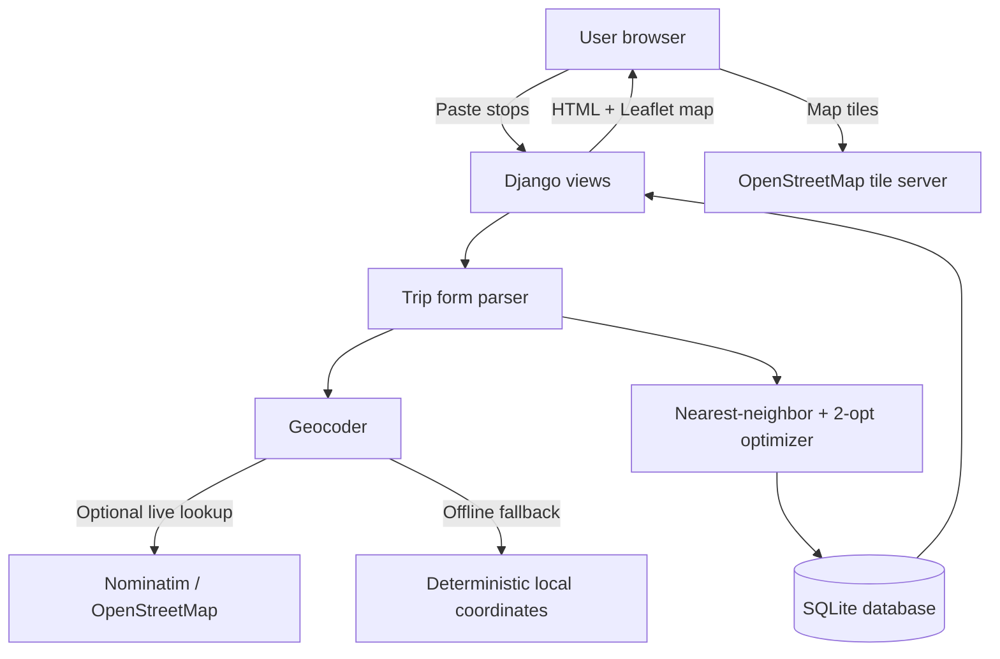

# Route Whisper

A tiny Django trip planner that turns a pasted list of places into an efficient walking route. Paste 5-20 stops, Route Whisper geocodes them, applies lightweight route optimization, and shows the reordered route as a list and map.

## Architecture



## Core feature

1. Open the home page.
2. Paste 5-20 locations, one per line.
3. Submit the form.
4. See an optimized walking route with:
   - Ordered stop list
   - Estimated total straight-line walking distance
   - Interactive Leaflet map with route polyline

## Input format

One stop per line. Any of these work:

```text
Eiffel Tower
Louvre Museum
Notre-Dame Cathedral
Luxembourg Gardens
Arc de Triomphe
```

For fully offline, deterministic coordinates you can also paste coordinates:

```text
Home Base | 40.7580,-73.9855
Bryant Park | 40.7536,-73.9832
Grand Central | 40.7527,-73.9772
Empire State Building | 40.7484,-73.9857
Flatiron Building | 40.7411,-73.9897
```

## Run instructions

### Option A: Local Python

```bash
cd brain-route-whisper
python -m venv .venv
source .venv/bin/activate  # Windows: .venv\Scripts\activate
pip install -r requirements.txt
python manage.py migrate
python manage.py seed_demo
python manage.py runserver
```

Visit http://127.0.0.1:8000

### Option B: Docker

```bash
cd brain-route-whisper
docker compose up --build
```

Visit http://127.0.0.1:8000

## Environment variables

Copy `.env.example` to `.env` if you want to customize settings.

| Variable | Default | Description |
| --- | --- | --- |
| `DJANGO_SECRET_KEY` | development-only key | Django signing secret. Use a secure random value in production. |
| `DJANGO_DEBUG` | `1` | Set to `0` in production. |
| `DJANGO_ALLOWED_HOSTS` | `localhost,127.0.0.1` | Comma-separated allowed hosts. |
| `ROUTE_WHISPER_ENABLE_ONLINE_GEOCODING` | `1` | Set to `0` to disable Nominatim calls and use offline fallback/coordinates only. |
| `NOMINATIM_USER_AGENT` | `route-whisper-mvp` | User agent sent to Nominatim when online geocoding is enabled. |

## Notes

- The optimizer uses nearest-neighbor construction plus a small 2-opt improvement pass.
- Distances are haversine straight-line estimates, suitable for lightweight planning but not turn-by-turn navigation.
- Online geocoding uses public OpenStreetMap Nominatim and may be rate-limited. The app still works offline by parsing pasted coordinates or assigning stable fallback coordinates near a city center.
